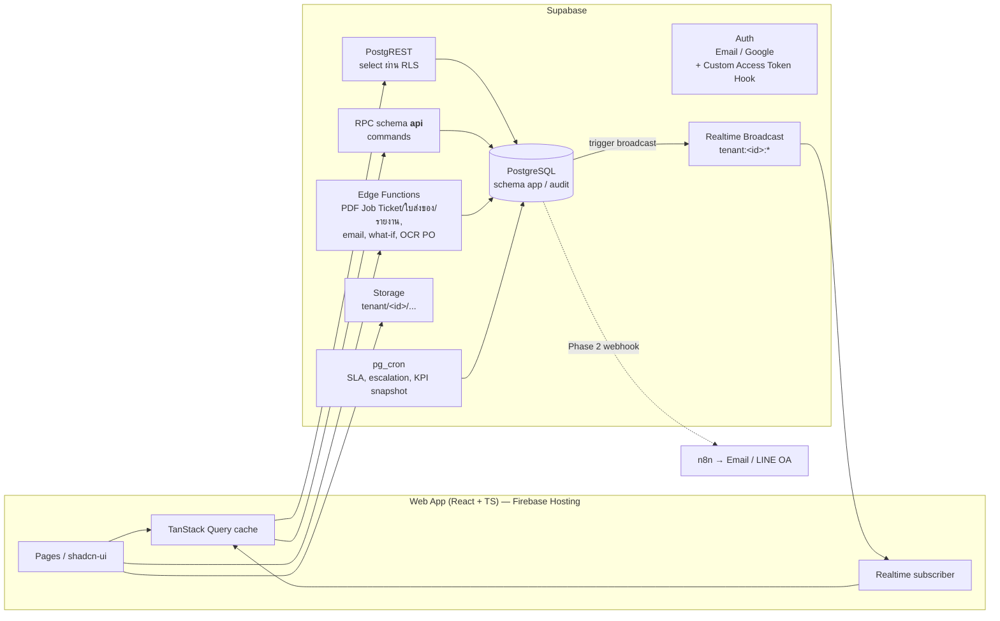
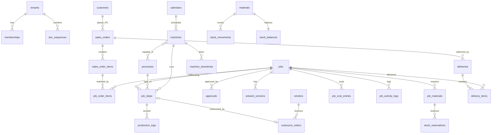
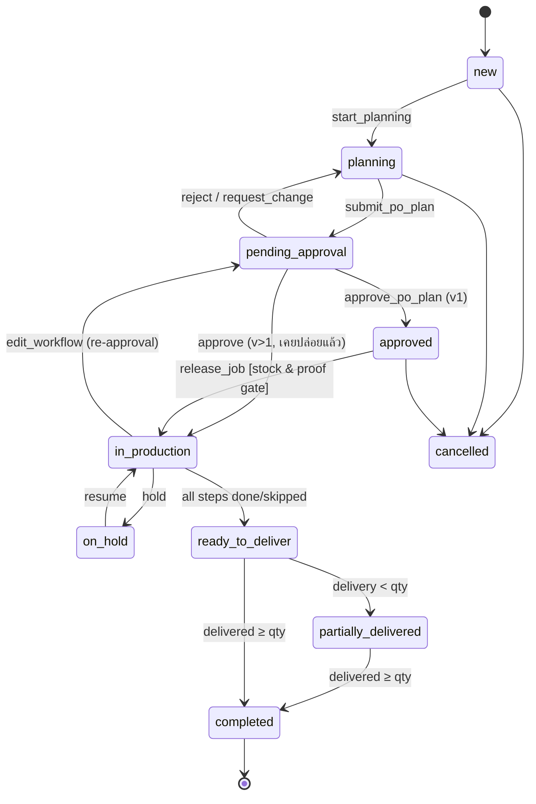
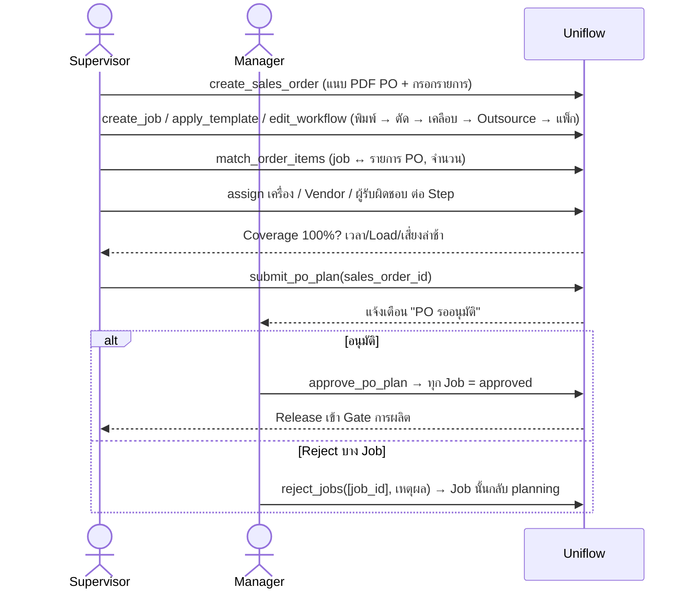

# Uniflow — System Design

> Uniflow = ระบบ Smart Printing MRP (SaaS Multi-tenant สำหรับโรงพิมพ์ SME)
> อ้างอิง: SRS v1.0 และ [01-srs-analysis.md](01-srs-analysis.md) (รหัส G-xx = ช่องว่างที่ออกแบบแก้ไว้)
> สถานะ: Draft v0.4 · 27 ต.ค. 2026 — อัปเดตตาม Decision Log (D-01…D-23) ใน [01-srs-analysis.md §4](01-srs-analysis.md)

**ขอบเขต:** Uniflow เป็น **MRP** — ต้นทางคือ **PO ที่ลูกค้ายืนยันแล้ว** → Sales Order → Production Order (Job) → Gate การผลิต → ส่งมอบ; **ไม่มีโมดูลใบเสนอราคาและไม่เกี่ยวกับบัญชี** (D-09, D-10)

**เป้าหมาย (D-20):** บริหารและจัดการงานผลิต — ผู้บริหารเห็นคิวและ Load ของเครื่องพิมพ์/เครื่องจักร และได้ **รายงานสนับสนุนการตัดสินใจ** ว่าควรซื้อเครื่องเพิ่ม เพิ่มคน หรือปรับการผลิตอย่างไร (§9)

## 1. หลักการออกแบบ

1. **Database is the rulebook** — กฎทุกข้อที่กระทบความถูกต้อง (Approval / Proof / Stock Gate, State transition, SoD, Tenant isolation) บังคับใน PostgreSQL ไม่ใช่ที่หน้าจอ
2. **Writes go through commands** — ตารางธุรกรรมหลัก (jobs, job_steps, stock, approvals) Client *อ่าน* ผ่าน RLS แต่ *เขียน* ผ่าน RPC เท่านั้น; Master Data ที่ไม่มี State เขียนตรงได้ภายใต้ RLS
3. **Tenant from day one** — `tenant_id` ทุกตาราง + RLS + Storage path + Realtime channel
4. **Gates are configurable** — Gate ที่โมดูลยังไม่ถูกเปิด (Inventory/Design) ปิดได้ต่อ tenant เพื่อให้ MVP ใช้งานจริงได้ (G-15)
5. **PO is the entry point** — ทุกงานเริ่มจาก PO ลูกค้าที่ยืนยันแล้ว ราคาขายในระบบมาจาก PO (ใช้คิด Margin) ระบบไม่ทำหน้าที่เสนอราคา
6. **Everything is an event** — ทุกการเปลี่ยนสถานะเขียน `job_activity_logs` → ใช้ทั้ง Timeline, KPI และ Realtime

## 2. สถาปัตยกรรม



### 2.1 Tech Stack

| Layer | เลือก | เหตุผล |
|---|---|---|
| Frontend | **Vite + React 19 + TypeScript**, TanStack Router + Query, Tailwind + shadcn/ui, react-hook-form + zod, i18next (th/en) | แอปอยู่หลัง Login ไม่ต้อง SSR → SPA เร็วกว่าและ deploy ง่าย |
| Board | `@dnd-kit` (Kanban/Queue), Timeline สร้างเองด้วย CSS Grid + virtualized rows | frappe-gantt ปรับให้ลากข้ามเครื่องยาก; ควบคุม UX เองดีกว่า |
| Backend | Supabase: Postgres 15+, RLS, PL/pgSQL RPC, pg_cron, Realtime Broadcast, Storage | ตาม SRS §9 |
| Server tasks | Supabase Edge Functions (Deno) | PDF Job Ticket (QR) / ใบส่งของ, ส่ง Email, Export รายงาน (PDF/Excel), What-if simulation, OCR PO (Phase 4) |
| Types | `supabase gen types` → แชร์ใน `packages/db-types` | Type-safe end-to-end |
| Test | pgTAP (rules + RLS), Vitest (UI logic), Playwright (E2E) | ตาม SRS §15 |
| Hosting (D-23) | **Firebase Hosting** สำหรับ SPA (CDN ทั่วโลก, HTTPS อัตโนมัติ, rewrite ทุก path → `index.html`, cache ยาวสำหรับ assets ที่มี hash) + **Preview channels** ต่อ PR; Backend/DB ทั้งหมดอยู่บน **Supabase** (Postgres, Auth, Storage, Realtime, Edge Functions) — ไม่ใช้ Firestore/Firebase Auth เพื่อให้มี Auth และ RLS ชุดเดียว | แยกชัด: Firebase = เสิร์ฟหน้าเว็บ, Supabase = ข้อมูลและกฎ |
| CI/CD | GitHub Actions: `supabase db push` (migrate) → pgTAP + RLS test → typecheck → build → `firebase deploy --only hosting` (PR → preview channel + Supabase branch, main → production) → Playwright E2E บน preview URL | RLS test ทุก release (SRS §12) |

### 2.2 โครงสร้าง Repository

```
uniflow/
├── apps/web/                    # React SPA
│   └── src/
│       ├── app/                 # router, layout, providers
│       ├── modules/             # 1 โฟลเดอร์ต่อโมดูลธุรกิจ
│       │   ├── masters/  sales/  jobs/  board/  outsource/
│       │   ├── inventory/  delivery/  dashboard/  admin/
│       │   └── <module>/{api.ts, hooks.ts, components/, pages/}
│       ├── shared/              # ui kit, formatters, i18n, auth
│       └── lib/supabase.ts
├── packages/db-types/           # generated types
├── supabase/
│   ├── migrations/              # แหล่งความจริงเดียวของ schema
│   ├── functions/               # edge functions
│   ├── tests/                   # pgTAP
│   └── seed.sql                 # demo tenant + เครื่องจักร/Process ตัวอย่าง
├── firebase.json                # Hosting: public=apps/web/dist, SPA rewrite, cache headers
├── .firebaserc                  # projects: staging / production
└── docs/
```

## 3. Domain Modules (Modular Monolith)

| Module | ความรับผิดชอบ | ตารางหลัก | Phase |
|---|---|---|---|
| **platform** | tenant, plan + limits (D-11), membership, settings, feature flags, doc numbering | tenants, plans, memberships, doc_sequences | 1 |
| **masters** | ลูกค้า, เครื่อง, Process, Template, Vendor, Material, ปฏิทิน | customers, machines, processes, machine_processes, workflow_templates(+_steps), vendors, vendor_services, materials, calendars | 1 |
| **orders** | รับ PO ลูกค้า → Sales Order (แนบไฟล์ PO, รายการ/สเปค/ราคา/Due date) | sales_orders(+_items) | 1 |
| **production** | Job, Workflow, Approval, Step execution | jobs, job_steps, approvals, production_logs, job_activity_logs | 1 |
| **scheduling** | คิว, ตารางเวลา, Load, Downtime | (job_steps), machine_downtimes, machine_capacity_days | 1 |
| **design** | Artwork, Proof | artwork_versions | 2 |
| **outsource** | ใบสั่งจ้าง, คะแนน Vendor | outsource_orders | 2 |
| **inventory** | รับ/เบิก/ปรับ/คืน, จอง, Balance — คลังเดียว ไม่ติด Lot (D-08) | job_materials, stock_movements, stock_reservations, stock_balances | 2 (D-01) |
| **delivery** | ใบส่งของ, ปิดงาน | deliveries, delivery_items | 2 |
| **costing** | ต้นทุนจริง, Margin | job_cost_entries | 3 |
| **insight** | KPI, Dashboard, Notification | kpi_daily_snapshots, notifications | 1–3 |

กฎ: โมดูลอ้างถึงกันผ่าน FK และ RPC ของอีกโมดูลเท่านั้น ห้าม RPC โมดูลหนึ่งไปแก้ตารางของอีกโมดูลตรงๆ (เช่น production เรียก `inventory.reserve_for_job()` ไม่ใช่ insert stock เอง)

## 4. Multi-tenancy & Security

### 4.1 Identity & Membership (แก้ G-12)

```sql
create table app.memberships (
  id         uuid primary key default gen_random_uuid(),
  tenant_id  uuid not null references app.tenants,
  user_id    uuid not null references auth.users,
  roles      app.role[] not null,          -- {admin, executive, manager, supervisor, staff}
  is_active  boolean not null default true,
  unique (tenant_id, user_id)
);
```

- **Custom Access Token Hook** ใส่ `tenant_id` (tenant ที่เลือกอยู่) และ `roles` ลงใน JWT → RLS ไม่ต้อง join ทุก query
- เปลี่ยน tenant = เรียก `api.switch_tenant(tenant_id)` แล้ว refresh session
- Super Admin (ผู้ให้บริการ) อยู่นอก RLS ผ่าน service role ในแอป Back-office แยก — ไม่ใช้ในแอปลูกค้า

### 4.2 RLS Pattern

```sql
create function app.tenant_id() returns uuid language sql stable as $$
  select nullif(auth.jwt() ->> 'tenant_id', '')::uuid $$;

create function app.has_role(variadic r app.role[]) returns boolean language sql stable as $$
  select coalesce((auth.jwt() -> 'roles')::jsonb ?| r::text[], false) $$;

-- ทุกตาราง: อ่านได้เฉพาะ tenant ตน
create policy tenant_read on app.jobs for select
  using (tenant_id = app.tenant_id());

-- ตารางธุรกรรม: ไม่มี insert/update/delete policy → เขียนผ่าน api.* (security definer) เท่านั้น
-- Master data: เขียนตรงได้ตาม role
create policy machines_write on app.machines for all
  using (tenant_id = app.tenant_id() and app.has_role('admin','manager'))
  with check (tenant_id = app.tenant_id());
```

- คอลัมน์ต้นทุน (`est_cost`, `actual_cost`, `cost_per_hour`, `avg_cost`) ซ่อนจาก Supervisor/Staff ด้วย **view** `app.jobs_v` ที่คืน `null` ถ้าไม่มีสิทธิ์ (RBAC: ต้นทุน/Margin)
- Staff อัปเดตได้เฉพาะ Step ที่ `assignee_id = auth.uid()` หรือเครื่องที่ตนประจำ — ตรวจใน RPC
- Storage path: `{tenant_id}/{entity}/{id}/{file}` + policy เทียบ segment แรกกับ `app.tenant_id()`; ดาวน์โหลดผ่าน signed URL
- `audit.logs` อยู่ schema แยก, ไม่มี update/delete grant แม้แต่ service role ของแอป (เขียนผ่าน trigger `security definer`)

### 4.3 RBAC สรุปสิทธิ์ที่บังคับใน RPC

| Command | อนุญาต | เงื่อนไขเพิ่ม |
|---|---|---|
| `submit_po_plan` | supervisor, manager | ทุก Job ของ SO อยู่ `planning`, มี ≥ 1 Step, และ **match รายการ PO ครบ 100%** (BR-R11) |
| `approve_po_plan` / `reject_jobs` / `request_change` | manager | ผู้อนุมัติ ≠ ผู้ submit ล่าสุด — เว้น tenant เปิด `allow_self_approval` (ค่าเริ่มต้นปิด) ซึ่งจะบันทึก `approvals.self_approved = true` + audit (D-05, BR-R02) |
| `release_job` | supervisor, manager | Gate ผ่าน หรือ manager override + เหตุผล |
| `move_step` (ลากการ์ด) | supervisor, manager | ดู §6.3 |
| `start/pause/complete_step` | staff (งานตน), supervisor, manager | Step = `ready`/`paused` |
| `override_stock_gate` | manager | ต้องมี reason |

## 5. Data Model

ปรับจาก SRS §8 — ตารางใหม่/เปลี่ยนแปลงมีเครื่องหมาย ★



### 5.1 ตารางที่เปลี่ยนจาก SRS

| ตาราง | การเปลี่ยนแปลง | เหตุผล |
|---|---|---|
| ★ `memberships` | แทน `profiles.role` ด้วย `roles[]` ต่อ tenant; `profiles` เหลือข้อมูลบุคคล | G-12 |
| ★ `doc_sequences` | `(tenant_id, doc_type, period) → last_no` | G-16 |
| `tenants.settings` | เพิ่ม `timezone`, `features {proof_gate, stock_gate}`, `allow_self_approval` (default false), `doc_format` (default `{prefix}-{YYYY}-{0000}`, reset yearly), `overhead_pct` | G-15, D-05, D-06, D-03 |
| ★ `plans` | `name, limits jsonb {max_users, max_machines}`, ตรวจใน RPC `invite_member` / insert machines | D-11 |
| `machines` | + `cost_per_hour` (tenant กรอกเอง, จำเป็นสำหรับ Costing), `makeready_waste_units`, `calendar_id`; status enum | G-09, G-11, D-03 |
| `processes` | + `default_running_waste_pct`, `capacity_unit` | G-10, G-11 |
| `jobs` | + `sales_order_id`, `proof_required`, `released_at`, `is_at_risk`, `planned_finish_at`, `version` (optimistic lock) | G-01, G-03, G-22 |
| `job_steps` | + `seq` = ระดับ (Step ที่ seq เท่ากันทำขนานได้ — D-07), `n_up`, `passes` (ระดับ Step — D-02), `input_qty`, `is_rework`, `rework_of_step_id`, `workflow_version` | G-06, G-07, G-10, G-04 |
| `sales_orders` | ตัด `quotation_id`; + `customer_po_no` (unique ต่อ customer), `po_date`, `po_file_path`, `status (draft/confirmed/in_progress/delivered/closed/cancelled)` | D-09 |
| ★ `sales_order_items` | กรอกจาก PO: `line_no, description, spec jsonb (ขนาด/กระดาษ/สี/finishing), qty, uom, unit_price, due_date` | G-22, D-09 |
| ★ `job_order_items` | `job_id, sales_order_item_id, qty` — M:N: 1 รายการแตกได้หลาย Job และ 1 Job รวมได้หลายรายการ (gang run) | D-14 |
| ★ `stock_reservations`, ★ `stock_balances` | แยกการจองออกจาก movement; ทุกตาราง stock มี `warehouse_id` (default คลังหลักคลังเดียว) เพื่อขยายภายหลัง | G-13, D-08 |
| `delivery_items` | + `job_id`, `qty` | G-21 |
| ★ `job_cost_entries` | `job_id, source (material/machine/outsource/overhead), ref_id, amount` | G-09 |
| ★ `machine_capacity_days` | `(machine_id, day) → available_min, planned_min` (cache สำหรับ Load %) | NFR performance |
| ★ `notifications` | `user_id, type, entity, read_at` | M11 |
| ~~`quotations`, `quotation_items`~~ | **ตัดออก** | D-09 |
| `memberships` | + `skills process_id[]` (Process ที่ทำได้), `calendar_id` (กะของพนักงาน) | D-20 แรงงาน |
| `machines` / `processes` | + `crew_size` (จำนวนคนที่ต้องใช้ต่อเครื่องขณะทำงาน) | D-20 แรงงาน |
| `production_logs` | + `operator_ids uuid[]`, `setup_min`, `run_min` แยกกัน | OEE, แรงงาน |
| `machine_downtimes` | `reason` เป็น enum: `breakdown, planned_maintenance, no_operator, no_material, waiting_approval, changeover, other` | แยกสาเหตุเพื่อตัดสินใจ: ซื้อเครื่อง vs เพิ่มคน vs แก้กระบวนการ |
| ★ `machine_daily_stats` | `(machine_id, day)`: `available_min, planned_min, run_min, setup_min, downtime_min by reason, good_qty, waste_qty, ideal_units` — เขียนทุกคืนด้วย pg_cron | ฐานของรายงาน §9 |
| ★ `labor_daily_stats` | `(process_id, day)`: `available_staff_min, required_staff_min, actual_staff_min, overtime_min` | §9 เพิ่มคน |
| ★ `scenarios` | `name, params jsonb (เพิ่มเครื่อง/กะ/OT/คน/Outsource), result jsonb, created_by` | §9 What-if |

### 5.2 Enums

```sql
create type app.job_status  as enum ('new','planning','pending_approval','approved',
  'in_production','on_hold','ready_to_deliver','partially_delivered','completed','cancelled');
create type app.step_status as enum ('pending','ready','in_progress','paused','done','skipped','failed');
create type app.step_type   as enum ('design','internal','outsource','qc','delivery');
create type app.machine_status as enum ('active','maintenance','inactive');
```

## 6. Core Mechanisms

### 6.1 Job State Machine



ทุก transition ผ่านฟังก์ชันเดียว `app.transition_job(job_id, to_status, ctx jsonb)` ซึ่ง (1) ตรวจตาราง `app.job_transitions(from, to, required_role)` (2) lock แถว (3) เขียน activity log (4) broadcast — RPC ระดับบนเป็นแค่ wrapper ที่ตรวจเงื่อนไขธุรกิจเพิ่ม

### 6.2 Step Readiness (Gate Engine)

Step เปลี่ยน `pending → ready` อัตโนมัติ (trigger หลัง Step ใดๆ เปลี่ยนสถานะ หรือ Proof อนุมัติ) เมื่อ **ทุกข้อ** จริง:

1. Job อยู่ `in_production` และไม่อยู่ระหว่าง re-approval สำหรับ Step ที่ยังไม่เริ่ม (G-02)
2. ทุก Step ที่ `seq` น้อยกว่า อยู่ `done` / `skipped` (G-06)
3. ถ้า `proof_gate` เปิด และ `jobs.proof_required` และ Step ไม่ใช่ `design` → มี artwork ที่ `proof_status = approved` (BR-R03, G-03)
4. ถ้าเป็น Step ที่ใช้เครื่อง → เครื่อง `active`

Staff เห็นเฉพาะการ์ด `ready / in_progress / paused` ของตน — UI จึงไม่ต้องรู้กฎ

### 6.3 Scheduling (แก้ G-05, G-10)

**เวลาต่อ Step (BR-R05 ฉบับแก้หน่วย):**

```
qty_unit    = ceil(input_qty ÷ n_up) × passes                 -- เช่น 5,000 ชิ้น ÷ 8-up × 1 pass = 625 แผ่น (n_up/passes ระดับ Step — D-02)
run_qty     = qty_unit × (1 + running_waste_pct) + makeready_waste_units
est_minutes = setup_min + run_qty ÷ (max_cap_per_hour × efficiency_pct) × 60
```

**Forward finite-capacity scheduling ต่อเครื่อง** — `app.reschedule_machine(machine_id, from_ts)`:

```
lock machine row (FOR UPDATE)            -- กันลากการ์ดพร้อมกัน
cursor := max(from_ts, now())
for step in steps on machine where status in (ready,pending,in_progress,paused)
            order by queue_position:
    earliest := max(cursor, finish ของ Step ระดับก่อนหน้าใน Job เดียวกัน)
    planned_start := next_working_minute(machine.calendar, earliest)   -- ข้ามวันหยุด/นอกกะ/downtime
    planned_end   := add_working_minutes(machine.calendar, planned_start, remaining_minutes(step))
    cursor := planned_end
upsert machine_capacity_days (planned_min ต่อวัน)                        -- ใช้คำนวณ Load % (BR-R06)
update jobs.planned_finish_at, is_at_risk = planned_finish_at > due_date
broadcast 'board.changed'
```

- เมื่อ Step ของ Job เลื่อน อาจกระทบเครื่องอื่นที่มี Step ระดับถัดไป → reschedule ต่อแบบ cascade (จำกัดรอบ + ทำใน job queue ถ้าเกิน 200 steps)
- Outsource step: `planned_end = planned_start + vendor lead time` (G-19)
- Step ขนาน (D-07): Step ที่ `seq` เท่ากันจัดลงคนละเครื่องและเริ่มพร้อมกันได้; Step ระดับถัดไปรอ `max(planned_end)` ของทุก Step ระดับก่อนหน้า
- Phase 3+: ปรับ `efficiency_pct` จาก actual/plan เฉลี่ย 30 วัน (SRS §12, AI §14)

**`api.move_step(step_id, machine_id, before_step_id, expected_version)`** ตรวจตาม FR-6.3:

| ตรวจ | ผล |
|---|---|
| เครื่องรองรับ Process (`machine_processes`) | ❌ Error |
| เครื่อง `active` (BR-R08) | ❌ Error |
| Step สถานะ `done/in_progress` | ❌ Error (ย้ายไม่ได้) |
| `expected_version` ไม่ตรง (มีคนแก้ก่อน) | ❌ Conflict → Client refetch |
| Load วันนั้น > 100% | ⚠ คืน `warnings[]` — ต้องส่ง `confirm=true` ซ้ำ |
| `planned_finish_at > due_date` | ⚠ เตือน + การ์ดแดง |

### 6.4 PO Planning & Approval (BR-R01–R04, D-14, D-15)



**BR-R11 (ใหม่) — Order Coverage:** สำหรับทุก `sales_order_items` ต้องมี Σ `job_order_items.qty` = `qty` ของรายการ (ไม่ขาด ไม่เกิน) จึง `submit_po_plan` ได้; ตรวจด้วย view `sales_order_coverage_v` ที่ Planner ใช้แสดงแถบความครบ

- หน่วยการ Submit = **ทั้ง PO** (ทุก Job ของ SO ไปพร้อมกัน) เพื่อให้ Manager เห็นภาพรวมทั้งใบ; หน่วยการอนุมัติ/Reject = **ราย Job** (Approve all ได้ในคลิกเดียว)
- Job ที่ถูก Reject แก้แล้ว Submit ใหม่เฉพาะ Job นั้นได้ (coverage ยังต้องครบ)
- `submit_po_plan` snapshot steps ลง `approvals.payload jsonb` + เพิ่ม `jobs.workflow_version`
- `approve` ตรวจ SoD จาก `approvals` แถว submit ล่าสุด (`actor_id`)
- แก้ Workflow หลังอนุมัติ = `api.edit_workflow(job_id, steps jsonb)`: ห้ามแตะ Step `done`; ถ้า Job เคย release → `in_production → pending_approval` — Step ที่ `in_progress`/`paused` ทำต่อจนจบได้ แต่ไม่มี Step ใดเปลี่ยนเป็น `ready` จนกว่าอนุมัติ (D-04)
- Escalation: pg_cron ทุก 15 นาที หา approvals ค้าง > 24 ชม. → notification ถึง manager + executive (7.4)

### 6.5 Inventory (G-08, G-13)

```
On Hand   = Σ stock_movements (in, return, adjust+) − Σ (out, adjust−)   -- เก็บใน stock_balances
Reserved  = Σ stock_reservations.qty ที่ยัง active
Available = On Hand − Reserved                                            -- FR-8.3
```

- `approve` → `inventory.reserve_for_job(job_id)` จองเท่าที่มี, ส่วนขาดบันทึกเป็น `job_materials.shortage_qty` + แจ้งเตือน
- `release_job` → ถ้า `stock_gate` เปิดและมี shortage → ปฏิเสธ เว้น manager ส่ง `override_reason` (BR-R07)
- เบิกจริง (`issue_material`) → movement `out` ด้วย `unit_cost = avg_cost` ปัจจุบัน + ลด reservation + เขียน `job_cost_entries`
- รับเข้า (`receive_goods`) → คำนวณ Moving Average ใหม่ใน transaction เดียวกัน (FR-8.4)
- ยกเลิก Job → ปล่อย reservation ทั้งหมด

### 6.6 Costing (G-09)

| แหล่ง | บันทึกเมื่อ | สูตร |
|---|---|---|
| material | `issue_material` / คืน | qty × avg_cost ณ ขณะเบิก |
| machine | `complete_step` | (actual_end − actual_start − paused) ชม. × machines.cost_per_hour (D-03; ถ้าเครื่องไม่มีอัตรา → เตือนใน Job Card ว่าต้นทุนไม่ครบ) |
| outsource | outsource order `received` | cost จริง |
| overhead | ปิด Job | (material + machine) × tenant.overhead_pct |

`jobs.actual_cost` = Σ `job_cost_entries`; Margin = (ราคาขายจาก PO / SO item × จำนวนของ Job − actual_cost) ÷ ราคาขาย

### 6.7 Document Numbering (BR-R10, G-16)

```sql
create function app.next_doc_no(p_type text) returns text language plpgsql as $$
declare v_no int; v_period text := to_char(now() at time zone app.tenant_tz(), 'YYYY');
begin
  insert into app.doc_sequences (tenant_id, doc_type, period, last_no)
  values (app.tenant_id(), p_type, v_period, 1)
  on conflict (tenant_id, doc_type, period)
  do update set last_no = app.doc_sequences.last_no + 1
  returning last_no into v_no;
  return format('%s-%s-%s', p_type, v_period, lpad(v_no::text, 4, '0'));   -- SO-2026-0001, JOB-2026-0001
end $$;
```

รูปแบบจริงอ่านจาก `tenants.settings.doc_format` (D-06): รองรับ `{YYYY}` ค.ศ., `{BBBB}` พ.ศ., `{MM}` และกำหนด period reset (`yearly`/`monthly`) — ค่าเริ่มต้น ค.ศ. รายปี; ตัวอย่างข้างบนเป็นค่าเริ่มต้น

### 6.8 Realtime (G-17)

- Trigger บน `job_steps`, `jobs`, `machines` เรียก `realtime.send(payload, event, 'tenant:'||tenant_id||':board', true)` ส่งเฉพาะ `{id, status, machine_id, queue_position, version}`
- Client รับ event → `queryClient.setQueryData` patch การ์ด หรือ invalidate เฉพาะ machine ที่เปลี่ยน
- Private channel authorize ด้วย RLS บน `realtime.messages`: topic ต้องขึ้นต้นด้วย `tenant:` + tenant_id ใน JWT

## 7. API Surface (schema `api`)

| กลุ่ม | RPC |
|---|---|
| platform | `switch_tenant`, `invite_member`, `set_member_roles`, `update_tenant_settings` |
| orders | `create_sales_order` (จาก PO ลูกค้า + แนบไฟล์), `update_sales_order`, `confirm_sales_order`, `cancel_sales_order` |
| production | `create_job(sales_order_id)`, `apply_template`, `edit_workflow`, `match_order_items(job_id, items[])`, `submit_po_plan(sales_order_id)`, `approve_po_plan(sales_order_id, job_ids?)`, `reject_jobs(job_ids, reason)`, `request_change`, `release_job`, `hold_job`, `resume_job`, `cancel_job` |
| shop floor | `start_step`, `pause_step`, `complete_step(good_qty, waste_qty, reason)`, `create_rework_step`, `skip_step` |
| scheduling | `move_step`, `move_steps_bulk`, `unschedule_step`, `reschedule_machine`, `log_downtime`, `suggest_alternative_machines(step_id)` |
| design | `upload_artwork` (หลัง upload Storage), `record_proof(version_id, status, evidence_url)` |
| outsource | `create_outsource_order`, `update_outsource_status`, `qc_outsource` |
| inventory | `receive_goods`, `issue_material`, `return_material`, `adjust_stock`, `reserve_for_job`, `override_stock_gate` |
| delivery | `create_delivery(items)`, `confirm_delivery(proof_url, receiver)` |
| insight | `get_dashboard(range)`, `get_machine_load(from, to, group_by)`, `get_capacity_forecast(weeks)`, `get_bottlenecks(range)`, `get_oee(range, machine_id?)`, `get_labor_load(range)`, `get_make_vs_buy(process_id, range)`, `promise_date(spec)`, `run_scenario(params)`, `export_report(type, range)`, `mark_notification_read` |

ทุก RPC: `security definer`, `set search_path = ''`, ตรวจ `app.tenant_id()` + role ที่บรรทัดแรก, คืน `jsonb` ที่มี `{data, warnings[]}`; Error ใช้ `raise exception using errcode = 'P0001', detail = '<code>'` ให้ Client แปลข้อความ th/en

**Read side** ใช้ PostgREST บน views: `jobs_v` (ซ่อนต้นทุนตาม role), `board_cards_v`, `machine_load_v`, `job_card_v`, `stock_v`

## 8. หน้าจอหลัก (UX Map)

| หน้า | ผู้ใช้หลัก | หมายเหตุ |
|---|---|---|
| Dashboard ผู้บริหาร | Executive, Manager | KPI 6 ตัว, งานเสี่ยง, รออนุมัติ, Load heatmap, drill-down |
| Project Status Board | ทุก role | Card ต่อ Job, filter ลูกค้า/สถานะ/เสี่ยง |
| PO Intake / Sales Order | Supervisor, Manager | Upload PDF PO → แสดง PDF ซ้าย / ฟอร์มรายการขวา (D-13); Phase 4: OCR เติมรายการให้อัตโนมัติ |
| Job Card | Supervisor, Manager | แท็บ: Workflow · Artwork · วัตถุดิบ · Activity · Approval · ต้นทุน |
| PO Planner | Supervisor | มุมมองต่อ PO: รายการ PO (ซ้าย, แถบ coverage) ↔ การ์ด Job (ขวา); ในการ์ด: เลือก Template → แก้ Step (ลากเรียง/ขนาน) → assign เครื่อง/Vendor → เห็นเวลา/Load/เสี่ยงล่าช้าสด → Submit ทั้ง PO |
| Approval Inbox | Manager | จัดกลุ่มตาม PO: ดูรายการ PO ↔ Job ↔ Flow, Approve all / Reject ราย Job, Diff ระหว่าง version (re-approval) |
| **Task Board (แบบ Trello)** | Supervisor, Manager (แก้ไข) · Executive (ดู) | การ์ด Task ต่อ Step, ลากโยกเครื่อง/ปรับคิว — รายละเอียด §8.1 |
| Shop Floor (มือถือ) | Staff | สแกน QR บน Job Ticket → ปุ่มใหญ่ Start/Pause/Complete + กรอกดี/เสีย (≤ 2 คลิก) |
| Outsource / Inventory / Delivery | ตามสิทธิ์ | List + Detail มาตรฐาน |
| Settings | Admin | ผู้ใช้, Master Data, ปฏิทิน, เลขเอกสาร, Feature flags |

### 8.0 หลักการ UX/UI (D-22)

เป้าหมาย: **ใช้งานได้โดยไม่ต้องอบรม** ทั้งผู้บริหาร Supervisor และ Staff หน้าเครื่อง — ทันสมัย สะอาด เร็ว คล้ายเครื่องมือยุคใหม่ (Linear, Trello, Notion) ไม่ใช่หน้าตา ERP แบบตาราง/ฟอร์มยาว

**1. Design System**

| องค์ประกอบ | แนวทาง |
|---|---|
| Component | shadcn/ui + Radix (accessible) ปรับ theme ของ Uniflow; รวมไว้ใน `shared/ui` ใช้ซ้ำทุกโมดูล |
| Typography | **IBM Plex Sans Thai** หรือ **Noto Sans Thai** (อ่านไทย/อังกฤษกลมกลืน), ตัวเลขแบบ tabular สำหรับตาราง/เวลา; ขนาดพื้นฐาน 14px (desktop) / 16px (มือถือ) |
| สี | Design tokens บน CSS variables: Neutral เป็นหลัก + สีแบรนด์ 1 สี; **สีสถานะชุดเดียวทั้งระบบ** — เทา Pending · น้ำเงิน Ready · ม่วง In progress · เหลือง Paused/เกินกำลัง · เขียว Done · แดง เสี่ยงเลย Due/Error; ผ่าน contrast WCAG AA |
| Theme | Light / **Dark mode** (หน้าเครื่องในโรงงานแสงน้อย และจอ Dashboard ที่เปิดทั้งวัน) |
| ไอคอน | Lucide ชุดเดียว เส้นบางสม่ำเสมอ |
| ระยะ/มุม | Spacing scale 4px, มุมโค้ง 8–12px, เงาบาง — ดูโปร่งไม่แน่น |
| Motion | Animation สั้น 150–200ms เฉพาะที่สื่อความหมาย (การ์ดย้าย, toast, drawer); เคารพ `prefers-reduced-motion` |

**2. หลักการใช้งาน**

- **งานหลักต้องจบใน ≤ 3 คลิก** — Staff: สแกน QR → Start/Complete (≤ 2 แตะ); Manager: Approve ทั้ง PO ในคลิกเดียว; Supervisor: ลากการ์ดเพื่อจัดคิว
- **เห็นผลก่อนทำ** — ทุกการกระทำที่กระทบแผน (ลากการ์ด, แก้ Flow, รับงานใหม่) แสดงผลกระทบล่วงหน้า (Load, วันเสร็จ, งานที่กระทบ)
- **Optimistic UI + Undo แทน Confirm dialog** — ทำทันที แล้วให้ toast "ย้ายแล้ว · เลิกทำ"; ใช้ dialog ยืนยันเฉพาะสิ่งที่ย้อนไม่ได้ (ยกเลิก Job, Override Gate)
- **Inline editing** — แก้จำนวน/วันที่/ผู้รับผิดชอบบนการ์ดหรือในตารางได้เลย ไม่ต้องเปิดฟอร์ม
- **Drawer แทนการเปลี่ยนหน้า** — คลิกการ์ด/แถว เปิด panel ด้านข้าง บริบทเดิมไม่หาย
- **Command palette (Ctrl/⌘ + K)** — ค้นหา Job/PO/ลูกค้า/เครื่อง และสั่งงาน ("ไปที่เครื่อง SM74", "สร้าง PO") + คีย์ลัดสำหรับผู้ใช้ประจำ
- **ข้อความเป็นภาษาคน** — Error บอกเหตุผลและทางแก้ ("เครื่อง SM74 ทำไดคัทไม่ได้ — ลองเครื่อง DC-01 หรือ DC-02"), ไม่แสดงรหัสเทคนิค
- **Empty state ที่พาไปต่อ** — หน้าว่างมีคำอธิบาย + ปุ่มขั้นถัดไป (เช่น "ยังไม่มีเครื่องจักร — เพิ่มเครื่องแรก หรือใช้ Template เครื่องมาตรฐาน")
- **Skeleton loading** และตอบสนอง < 100ms ต่อการคลิก (optimistic) แม้ Server ยังประมวลผล
- **Onboarding Wizard** สำหรับ tenant ใหม่: ข้อมูลบริษัท → เครื่องจักร (จาก Template) → Process → พนักงาน → Workflow Template ตัวอย่าง → PO แรก พร้อม checklist ความคืบหน้า

**3. ออกแบบตามผู้ใช้**

| ผู้ใช้ | อุปกรณ์หลัก | แนวทาง |
|---|---|---|
| ผู้บริหาร | Desktop / iPad / จอ TV ในโรงงาน | Dashboard อ่านได้ใน 5 วินาที: ตัวเลขใหญ่ + แนวโน้ม + สีสถานะ; **โหมด TV** (เต็มจอ, auto-refresh, วนหน้า Board/Load); ทุกตัวเลขคลิกเจาะลึกได้ |
| Supervisor | Desktop จอใหญ่ | ความหนาแน่นข้อมูลสูงได้ (compact mode), Board + Drawer, คีย์ลัด, ลากหลายการ์ด |
| Manager | Desktop / มือถือ | Approval Inbox ใช้บนมือถือได้ — อนุมัติจากแจ้งเตือนได้ทันที |
| Staff | มือถือ / แท็บเล็ตติดเครื่อง | **Mobile-first**: ปุ่มใหญ่ ≥ 48px, ตัวอักษรใหญ่, ใช้ได้ขณะใส่ถุงมือ, ข้อความน้อย ไอคอน+สีชัด, ตัวเลขกรอกด้วย numpad, ทำงานต่อได้ถ้าเน็ตหลุดชั่วคราว (คิวคำสั่งแล้ว sync) |

**4. คุณภาพและการวัดผล**

- Phase 0: ทำ **Clickable prototype (Figma)** ของ PO Intake, Task Board, Shop Floor, Executive Dashboard → ทดสอบกับผู้ใช้จริงของ Pilot (≥ 5 คนต่อ role) ก่อนเขียนโค้ด
- วัดผล: เวลาทำงานหลัก (เช่น กรอก PO 1 ใบ < 3 นาที, จัดคิวงานใหม่ < 30 วินาที), อัตราทำสำเร็จโดยไม่ต้องช่วย, **SUS score ≥ 75**, % Step ที่ Staff อัปเดตทันเวลา
- Accessibility: keyboard ใช้ได้ทุกหน้า (รวม drag & drop ผ่าน dnd-kit keyboard sensor), focus ring ชัด, ไม่สื่อความหมายด้วยสีอย่างเดียว (มีไอคอน/ข้อความประกอบ)
- รองรับไทย/อังกฤษสลับได้ทันที, วันที่แสดงแบบไทยอ่านง่าย ("พรุ่งนี้ 09:00", "อีก 2 วัน")

### 8.1 Task Board แบบ Trello (D-21)

บอร์ดหลักของระบบ — ทำงานเหมือน Trello แต่ทุกการลากผ่าน **scheduler + กฎการผลิต** (§6.3) จึงเห็นผลกระทบต่อคิว/Load/Due date ทันที

**โครงสร้าง**

- **การ์ด = Task** = 1 `job_step` (เช่น "พิมพ์ออฟเซ็ท 4 สี — JOB-2026-0012") ไม่ใช่ทั้ง Job — Job เดียวจึงมีหลายการ์ดกระจายอยู่ตามเครื่อง และเชื่อมกันด้วยสี/รหัส Job
- **คอลัมน์ (List) = เครื่องจักร** เรียงตาม Process group (พิมพ์ / ตัด / เคลือบ / ไดคัท / แพ็ก) + คอลัมน์พิเศษ:
  - **"รอจัดคิว"** — Step ที่อนุมัติแล้วแต่ยังไม่ลงเครื่อง (ลากจากที่นี่ไปเครื่อง = assign)
  - **Outsource** — 1 คอลัมน์ต่อ Vendor
  - **งานคน/ไม่ใช้เครื่อง** (QC, แพ็ก) — คอลัมน์ต่อทีมหรือผู้รับผิดชอบ
- **ลำดับการ์ดในคอลัมน์ = คิวจริง** (`queue_position`) บนสุดคืองานถัดไป
- หัวคอลัมน์: ชื่อเครื่อง, สถานะ (Active/Maintenance), **Load % วันนี้/สัปดาห์** (แถบสี), Backlog ชม., ผู้ประจำเครื่อง

**หน้าตาการ์ด**

```
┌──────────────────────────────────────┐
│ ● JOB-2026-0012 · Step 3/6       🔴 │ ← สีตาม Job, จุดแดง = เสี่ยงเลย Due
│ พิมพ์ออฟเซ็ท 4 สี                     │
│ กล่องครีม ABC · 5,000 ชิ้น (625 แผ่น) │
│ ⏱ 2.5 ชม. · 28 ต.ค. 09:00–11:30      │
│ 📅 Due 31 ต.ค. · 👤 สมชาย            │
│ [Ready] ▓▓▓▓░░ Job 60%               │
└──────────────────────────────────────┘
```

สถานะการ์ด: Pending (เทา, ยังเริ่มไม่ได้ — แสดงเหตุผล เช่น "รอ Proof", "รอ Step ก่อนหน้า") · Ready · In progress (มีเวลาเดินจริง) · Paused · Done (ซ่อนได้)

**การกระทำ (Interactions)**

| การกระทำ | ผล | RPC |
|---|---|---|
| ลากขึ้น/ลงในคอลัมน์เดียวกัน | **ปรับคิว** — คำนวณเวลาเริ่ม/เสร็จใหม่ทั้งคอลัมน์ | `move_step(step, same machine, before_step)` |
| ลากไปคอลัมน์เครื่องอื่น | **โยกเครื่อง** — คำนวณเวลาใหม่ทั้งสองเครื่อง (ความเร็ว/Setup ต่างกัน → เวลา Step เปลี่ยน) | `move_step(step, new machine, before_step)` |
| ลากจาก "รอจัดคิว" → เครื่อง | Assign ลงเครื่อง | `move_step` |
| ลากกลับ "รอจัดคิว" | ถอดออกจากคิว | `unschedule_step` |
| เลือกหลายการ์ด + ย้าย | ย้ายทั้งชุด (เช่น เครื่องเสีย → ย้ายทุกงาน) | `move_steps_bulk` |
| คลิกการ์ด | เปิด drawer: รายละเอียด Step, Flow ทั้ง Job (ไฮไลต์ Step นี้), Log, ปุ่ม Start/Pause/Complete | — |
| ปุ่ม "แนะนำเครื่อง" | แสดงเครื่องที่ทำ Process ได้ เรียงตามวันเสร็จเร็วสุด | `suggest_alternative_machines` |
| Undo (Ctrl+Z / toast) | ย้อนการย้ายล่าสุด (ถ้ายังไม่มีใครย้ายต่อ) | `move_step` กลับตำแหน่งเดิม |

**ขณะลาก (Live feedback)** — ก่อนปล่อยการ์ด UI แสดงผลจากการคำนวณฝั่ง Client (สูตรเดียวกับ §6.3) แล้วยืนยันด้วย Server เมื่อปล่อย:

- คอลัมน์ที่ **วางไม่ได้** เป็นสีเทา: เครื่องไม่รองรับ Process, เครื่อง Maintenance/Inactive (BR-R08)
- คอลัมน์ที่วางได้แสดง **Load % หลังวาง** และเวลาเสร็จคาดการณ์
- ถ้า Load > 100% → เหลือง "เกินกำลัง — ยืนยัน?" (Supervisor ยืนยันได้, FR-6.3)
- ถ้าทำให้ Job ใด (รวมงานอื่นที่ถูกดันคิว) เลย Due → แดง พร้อมรายชื่อ Job ที่กระทบ
- ห้ามลากการ์ด In progress / Done; การ์ดที่ Step ก่อนหน้ายังไม่เสร็จ ลากได้ (จัดคิวล่วงหน้า) แต่เริ่มไม่ได้จนกว่าจะ Ready

**มุมมองและตัวกรอง**

- สลับมุมมอง: **Board (Trello)** · **Timeline/Gantt** (แกนเวลา × เครื่อง ลากเลื่อนได้เหมือนกัน) · **Kanban ตามสถานะ** (Pending/Ready/In progress/Done)
- ตัวกรอง: Process group, ลูกค้า, PO, Job, ผู้รับผิดชอบ, เฉพาะเสี่ยงล่าช้า, ช่วงวันที่; ค้นหาด้วยเลข Job/PO
- "Focus Job": คลิกรหัส Job → ไฮไลต์ทุกการ์ดของ Job นั้นทั้งบอร์ด เห็น Flow ข้ามเครื่อง
- Swimlane (option): แบ่งแถวตามวัน เพื่อดูว่าวันไหนเครื่องไหนแน่น

**สิทธิ์:** Supervisor/Manager ลากได้ · Staff เห็นเฉพาะคอลัมน์เครื่องตน และกด Start/Pause/Complete บนการ์ดตัวเอง · Executive ดูอย่างเดียว (ใช้ดูคิว/Load ตาม D-20)

**Realtime & Concurrency:** การย้ายของคนอื่นแสดงทันทีผ่าน Broadcast (§6.8) พร้อม animation; ถ้าสองคนลากการ์ดเดียวกัน คนหลังได้ Conflict (`expected_version`) → บอร์ดรีเฟรชคอลัมน์นั้นและแจ้ง "มีคนย้ายการ์ดนี้แล้ว"

**Implementation:** `@dnd-kit/core` + `@dnd-kit/sortable` (รองรับ touch/แท็บเล็ต และ keyboard), virtualized column เมื่อการ์ด > 50 ต่อคอลัมน์, optimistic update ด้วย TanStack Query แล้ว rollback ถ้า Server ปฏิเสธ; ทุกการย้ายบันทึก `job_activity_logs` (ใคร ย้ายจากไหนไปไหน เมื่อไร) → ใช้วิเคราะห์ว่าแผนถูกแก้บ่อยแค่ไหน

## 9. Management Insight & Decision Support (D-20)

หัวใจของ Uniflow คือให้ผู้บริหาร **เห็นคิว/Load ของเครื่องและคน** แล้วตัดสินใจจากข้อมูล ไม่ใช่ความรู้สึก — ทุกรายงานออกแบบจาก "คำถามที่ผู้บริหารต้องตอบ"

### 9.1 คำถาม → รายงาน → ข้อมูล

| การตัดสินใจ | คำถามที่ต้องตอบ | รายงาน / ตัวชี้วัด | สัญญาณที่ควรลงมือ |
|---|---|---|---|
| **ซื้อเครื่องจักรเพิ่ม** | เครื่อง/Process ไหนเป็นคอขวดจริง? | **Bottleneck report**: Load % เฉลี่ยรายสัปดาห์ต่อ Process group, Backlog ชม. รอคิว, เวลารอคิวเฉลี่ยของ Step, งานล่าช้าที่สาเหตุมาจากรอเครื่อง | Load > 85% ต่อเนื่อง ≥ 8 สัปดาห์ **และ** OEE ≥ 65% (ถ้า OEE ต่ำ → ปรับปรุงก่อนซื้อ) |
| | ซื้อเองคุ้มกว่าจ้างข้างนอกไหม? | **Make-vs-Buy**: ค่า Outsource ต่อปีของ Process นั้น vs (ชม.ที่ต้องใช้ × cost_per_hour ของเครื่องใหม่ + ค่างวด/ค่าเสื่อม ที่ผู้ใช้กรอก) → จุดคุ้มทุน (เดือน) | Payback < อายุใช้งานที่ผู้บริหารกำหนด |
| | เครื่องที่มีใช้เต็มประสิทธิภาพหรือยัง? | **OEE** = Availability × Performance × Quality ต่อเครื่อง + **Downtime Pareto** ตามสาเหตุ | Downtime `breakdown` สูง → ซ่อม/เปลี่ยน; `changeover` สูง → จัดคิวรวมงานสเปคใกล้กัน |
| **เพิ่มคน** | ขาดคนหรือขาดเครื่อง? | **Labor load** ต่อทักษะ: ชม.คนที่ต้องใช้ (Σ est_minutes × crew_size) vs ชม.คนที่มี; Downtime สาเหตุ `no_operator`; ชม. OT; Step ที่รอผู้รับผิดชอบ | Labor load > 90% หรือ `no_operator` > 5% ของเวลาเครื่อง ขณะที่ Machine load ยังไม่เต็ม |
| | เพิ่มกะดีกว่าซื้อเครื่องไหม? | What-if "เพิ่มกะ 2 บนเครื่อง X" vs "เพิ่มเครื่อง" → เทียบงานล่าช้าและ Load | — |
| **ตัดสินใจการผลิต** | รับงานใหม่ได้ไหม เสร็จเมื่อไร? | **Promise date**: จำลองแทรก Job ใหม่ลงคิวตาม Template → วันที่เสร็จได้จริง | เสร็จหลัง Due → OT / Outsource / ต่อรอง |
| | 4–8 สัปดาห์ข้างหน้าเต็มไหม? | **Capacity forecast** ต่อ Process: Load ที่จัดคิวแล้ว + Backlog ที่ยังไม่จัดคิว (Job planning/approved) | สัปดาห์ไหน > 100% → วางแผน OT/Outsource ล่วงหน้า |
| | งานไหนเสี่ยง ต้องเลื่อน/เร่ง? | **At-risk jobs** (planned_finish > due) + ผลกระทบถ้าเลื่อน | — |
| | เสียที่ไหนมากสุด? | **Waste report** ต่อเครื่อง/Process/สาเหตุ/ผู้ปฏิบัติงาน | Waste > ค่าเผื่อ → อบรม/ซ่อม |
| ภาพรวม | ส่งตรงเวลา? กำไร? | OTD %, Lead time, Job margin %, Approval cycle time (KPI เดิม SRS §2.4) | — |

### 9.2 สูตรหลัก

```
Load %        = planned_min ÷ available_min                         (BR-R06, ต่อเครื่อง/วัน/สัปดาห์/Process group)
Availability  = (available_min − downtime_min) ÷ available_min
Performance   = (good_qty + waste_qty) ÷ (run_min × max_cap_per_hour ÷ 60)
Quality       = good_qty ÷ (good_qty + waste_qty)
OEE           = Availability × Performance × Quality
Labor load %  = Σ(step est_minutes × crew_size) ÷ Σ(staff available minutes)   ต่อทักษะ (process)
Backlog hrs   = Σ remaining est_minutes ของ Step ที่ยังไม่เสร็จ ÷ 60   ต่อ Process
Payback (เดือน) = ราคาเครื่อง ÷ (ค่า Outsource ต่อเดือน − ต้นทุนผลิตเองต่อเดือน)
```

### 9.3 What-if Scenario

- `api.run_scenario(params)` เรียก **scheduler ตัวเดียวกับ §6.3** ในโหมด simulation (ทำงานบน temp table ใน transaction แล้ว rollback — ไม่กระทบคิวจริง)
- พารามิเตอร์: เพิ่ม/ปิดเครื่อง (สำเนาจากเครื่องที่มี), เพิ่มกะ/OT, เพิ่มคนต่อทักษะ, ย้าย Process ไป Outsource, แทรก Job สมมติ
- ผลลัพธ์: Load % ต่อเครื่อง/สัปดาห์, จำนวนงานล่าช้า, OTD คาดการณ์, เทียบกับ Baseline แบบ side-by-side; บันทึกใน `scenarios` เพื่อนำเสนอ/ย้อนดู

### 9.4 การเก็บข้อมูลและแสดงผล

- pg_cron ทุกคืน: `machine_daily_stats`, `labor_daily_stats`, `kpi_daily_snapshots` ต่อ tenant → รายงานย้อนหลังโหลดเร็ว ไม่ต้อง aggregate log ทุกครั้ง; ข้อมูล "วันนี้" คำนวณสด
- **ข้อมูลต้องเริ่มเก็บตั้งแต่ Phase 1** (ผู้ปฏิบัติงาน, setup/run แยกกัน, สาเหตุ downtime) แม้รายงานเต็มจะมา Phase 3 — เพราะการตัดสินใจซื้อเครื่องต้องมีประวัติหลายเดือน
- Executive Dashboard: Heatmap Load (เครื่อง × สัปดาห์), Capacity forecast, Top bottlenecks, OEE, At-risk jobs — ทุกตัวเลข drill-down ถึง Job Card (FR-10.4)
- Export รายงานเป็น PDF/Excel สำหรับประชุมผู้บริหาร
- ความแม่นยำของรายงานขึ้นกับการกดสถานะหน้างาน → แสดง **Data completeness %** (Step ที่มีเวลาจริงครบ) บน Dashboard เพื่อให้ผู้บริหารรู้ว่าเชื่อตัวเลขได้แค่ไหน

## 10. Non-Functional Design

| NFR | วิธีบรรลุ |
|---|---|
| Board < 2s (≤ 500 steps) | View `board_cards_v` ดึงครั้งเดียว + index `(tenant_id, machine_id, planned_start)`; virtualized list; Load จาก cache table |
| Realtime < 2s | Broadcast payload เล็ก (§6.8) |
| 200 tenants × 50 users | Shared DB + RLS ด้วย JWT claim (ไม่มี subquery ใน policy); Supabase Pro + compute ขนาดกลาง |
| Security | RLS test matrix อัตโนมัติ (ทุกตาราง × ทุก role × tenant อื่น), signed URL อายุสั้น, `search_path` ล็อกใน function |
| Audit ไม่แก้ไขได้ | schema `audit` แยก, revoke update/delete |
| Backup | PITR + ทดสอบ restore รายไตรมาส (runbook) |
| i18n | ข้อความ UI/Error code แปลผ่าน i18next; วันที่แสดงตาม tenant timezone |
| PDPA | `api.export_tenant_data` (Edge Function → zip), anonymize ลูกค้า (G-26) |

## 11. Testing Strategy

- **pgTAP** — สูตรเวลา/Load, ทุก transition ใน state machine (ทั้งที่ถูกและต้องถูกปฏิเสธ), SoD, Gate ทั้ง 3, Moving Average, เลขเอกสารพร้อมกัน
- **RLS matrix** — สคริปต์ generate test: สำหรับทุกตารางใน `app` ตรวจว่า user tenant B select/insert/update/delete ข้อมูล tenant A ไม่ได้ (รันทุก PR)
- **Playwright E2E** — PO → SO → Job → Plan → Approve → Release → Board drag → Staff complete → Delivery → Completed
- **UAT** กับโรงพิมพ์นำร่อง 2–4 สัปดาห์

## 12. Delivery Plan (ปรับจาก SRS §13)

| Phase | ขอบเขต | เปลี่ยนจาก SRS |
|---|---|---|
| 0 Discovery (2 สป.) | สัมภาษณ์ Pilot (มีแล้ว — D-12): เก็บข้อมูลเครื่อง/Process/อัตรา/ชม./crew size จริง, จำนวนพนักงานและทักษะ, ตัวอย่าง PO จริง, การตัดสินใจที่ผู้บริหารอยากให้รายงานตอบ; **Clickable prototype + Usability test** ของ PO Intake, Task Board, Shop Floor, Executive Dashboard กับผู้ใช้จริง (§8.0) | Seed ระบบด้วยข้อมูล Pilot แทนข้อมูลสมมติ |
| 1 MVP Core (8–10 สป.) | platform (plans/limits), masters (+ทักษะพนักงาน/crew size), PO Intake → Sales Order, Job + Workflow (รวม Step ขนาน) + Approval + Release, Scheduling Board + Shop Floor (บันทึกผู้ปฏิบัติงาน + สาเหตุ downtime), Project Board, **Executive view: คิว + Load เครื่อง**, `machine_daily_stats` เริ่มเก็บทุกคืน, in-app notification | Gate Stock/Proof มีโครงแต่ **ปิดเป็นค่าเริ่มต้น** (D-01); เพิ่ม Shop Floor มือถือ + QR |
| 2 Operations (6–8 สป.) | Inventory คลังเดียว + Reservation (เปิด stock_gate), Design/Proof (เปิด proof_gate), Outsource, Delivery, Email | ตัด Export บัญชี (D-10) |
| 3 Management Insight (6–8 สป.) | Costing, KPI snapshots, **รายงานสนับสนุนการตัดสินใจ §9** (Bottleneck, Capacity forecast, OEE, Labor load, Make-vs-Buy, Promise date), What-if scenario, Export PDF/Excel | เป็นแกนคุณค่าหลัก (D-20) — ข้อมูลเริ่มสะสมตั้งแต่ Phase 1 จึงมีประวัติ ≥ 3 เดือนเมื่อถึง Phase นี้ |
| 4 SaaS Scale | Billing ตามแพ็กเกจ (D-11), Onboarding Wizard, LINE OA (n8n), AI (OCR PO → Sales Order, ประมาณเวลา, แนะนำ Template จากสเปค PO) | OCR PO ขึ้นลำดับแรกของ AI เพราะ PO คือต้นทาง |

**Sprint แรกที่แนะนำ (2 สัปดาห์):** scaffold repo + Supabase local, migrations ของ platform/masters, JWT hook + RLS helpers + RLS test harness, หน้า Login/Tenant switch/Machine & Process master — เพื่อพิสูจน์ "tenant isolation" ก่อนทุกอย่าง
